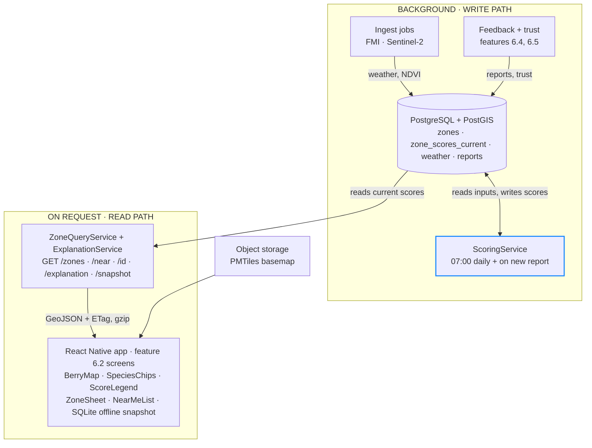

# Feature 6.2 Deep Dive – Live Site Map with Yield Score & Confidence

**Team:** Team Picky · Berry Picker Assistant  
**Date:** October 22, 2026  
**By:** @Someone

## 1. What we are building

A picker opens the app and sees, on a map of the forests around them, how good each zone is for a chosen berry right now: a yield score from **0–100**, a confidence level (**high / medium / low**), a ripeness stage, and a plain-words reason. This is the home screen of the app and the first thing every other feature plugs into, so it is built first (sprints 1–2, 21 October–17 November).

This document is self-contained: it lists everything that must exist before the map works (Sections 2–3), then the backend, data, scoring, screens, and stack needed to build it. It refines Section 6.2 of the MVP Architecture doc.

### User stories

- As a picker, I see coloured zones around my location within 3 seconds of opening the app.
- As a picker, I choose a berry (bilberry, lingonberry, cloudberry, crowberry) and the colours change to that species.
- As a picker, I tap a zone and see its score, confidence, ripeness, when it was updated, and why.
- As a picker, I see a **Near me** list of the best 10 zones within my radius, sorted by score and distance.
- As a picker in the forest without signal, I still see the last scores I downloaded, with a **last updated** label.
- As a picker, I can tell at a glance when a score is a guess (low confidence) and when it is backed by reports.

### Acceptance criteria (definition of done)

| ID | Criterion | How we check |
|---|---|---|
| A1 | Map loads zones for the visible area in under 3 s on 4G; API answers `GET /zones` in under 300 ms (p95) for a 20 × 20 km view. | API load test (k6/Locust) + stopwatch on a mid-range Android. |
| A2 | Every forest zone in the pilot area has a score for every species, even with zero reports. | SQL check: no zone × species without a `zone_scores` row today. |
| A3 | Colour = 5 score bands; low confidence shown as faded/hatched; legend always visible. | Visual review against Figma. |
| A4 | Zone sheet shows score, confidence, ripeness, updated time and at least 2 plain-words reasons. | Manual + snapshot test. |
| A5 | Species switch re-colours the map in under 1 s (no full reload). | Manual on device. |
| A6 | Offline: after one online session, the map, zones and last scores show in airplane mode. | Maestro E2E with network off. |
| A7 | Scores refresh daily at 07:00 and within 5 min of a new trusted report. | Job log + integration test. |
| A8 | Works on iOS 16+ and Android 10+. | EAS dev builds on 1 iPhone + 2 Androids. |

**Out of scope for this feature:** visit detection, feedback forms and push alerts (their own features). This feature only reads the reports they create.

## 2. Dependency map

The critical path runs through the zones (D10), the species phenology (D12) and weather (D13) into the baseline model, then the `ScoringService` and the zone API. If any of these slips, the map slips. Everything else has a stub (Section 3), so it can arrive later without blocking.

## 3. Dependency checklist

The map needs 21 things to exist first. None of them should block anyone: each has a stub the team uses until the real piece lands, so the app and backend can be built in parallel from day one. Update the Status column as work proceeds.

| ID | Dependency | Group | Owner | Needed by | Stub until ready | Status |
|---|---|---|---|---|---|---|
| D1 | GitHub monorepo (`app/`, `backend/`, `ml/`, `data/`, `ontology/`, `docs/`) + branch rules | Foundation | Sayeem | Oct 26, 2026 | — | Not started |
| D2 | Dev setup on every laptop: Git, Docker Desktop, Node LTS, Python 3.12, Android Studio emulator, Expo account | Foundation | Everyone (Sayeem checks) | Oct 26, 2026 | — | Not started |
| D3 | Pilot area bounding box agreed (≈ 60 × 60 km around Jyväskylä) | Data | Awais | Oct 26, 2026 | — | Not started |
| D4 | Postgres 17 + PostGIS + h3-pg Docker image | Foundation | Sabih + Hassan | Oct 28, 2026 | Plain `postgis/postgis` image; compute H3 in Python | Not started |
| D5 | FastAPI skeleton: config, DB session, Alembic, `/health`, error format | Backend | Hassan | Oct 28, 2026 | — | Not started |
| D6 | Species vocabulary: codes, FI/EN names, ontology IRIs (shared by DB + ontology) | Domain | Asmer + Hassan | Oct 30, 2026 | 4 hard-coded codes | Not started |
| D7 | OpenAPI contract for zone endpoints (Section 5) merged as YAML | Contract | Hassan + Salman | Oct 30, 2026 | Prism mock server from the YAML | Not started |
| D8 | Figma: map home, zone sheet, species chips, legend, offline banner | Design | Sabih | Oct 30, 2026 | Wireframe sketch in this doc (Section 8) | Not started |
| D9 | Expo dev build that includes MapLibre native module, runs on emulator + 1 phone | App | Salman | Oct 31, 2026 | — (must be early: native build issues take time) | Not started |
| D10 | Zones generated: forest mask → H3 res-8 cells → zones table + GeoJSON export | Data | Awais | Oct 31, 2026 | 50 hand-drawn test zones (`data/test_zones.geojson`) | Not started |
| D11 | `zone_species`: which species can grow in which zone (from forest/mire type) | Domain + Data | Asmer + Awais | Nov 3, 2026 | Every species allowed everywhere | Not started |
| D12 | Species phenology parameters: season window, GDD to flowering / ripe / past, with sources | Domain | Asmer | Nov 3, 2026 | Rough values marked “unverified” | Not started |
| D13 | Weather daily + GDD per zone, backfilled 2021–2026 | Data | Awais | Nov 3, 2026 | One FMI station for the whole area | Not started |
| D14 | NDVI per zone + anomaly | Data | Awais | Nov 10, 2026 | `ndvi_anomaly = 0` | Not started |
| D15 | Job runner: APScheduler + jobs table + worker loop | Backend | Hassan | Nov 5, 2026 | Run scoring by hand: `python -m app.jobs.score` | Not started |
| D16 | Phenology baseline model producing `S_model` + ripeness | ML | Remon | Nov 10, 2026 | Constant 50, ripeness from calendar dates | Not started |
| D17 | Reports + trust tables and service (from features 6.4 and 6.5) | Backend | Hassan | Nov 10, 2026 | Seeded reports, everyone trust 0.5 | Not started |
| D18 | Basemap: Finland PMTiles extract + MapLibre style JSON | Data + Map | Awais | Nov 5, 2026 | Public demo style (local dev only) | Not started |
| D19 | Object storage bucket with public-read `tiles/` and CORS | Cloud | Sabih | Nov 5, 2026 | MinIO in Docker Compose | Not started |
| D20 | VM + domain + HTTPS so phones can reach the API off-campus | Cloud | Sabih | Nov 10, 2026 | Laptop on same Wi-Fi, or a tunnel | Not started |
| D21 | Login + JWT (feature 6.1) protecting map endpoints | Backend | Hassan | Nov 3, 2026 | `DEV_AUTH_BYPASS=true` in local `.env` only | Not started |

**Accounts and keys to request now (lead time):** Copernicus Data Space account + OAuth client (Awais), NLS open-data API key (Awais), Expo/EAS account and Firebase project (Sabih), Apple Developer membership for iOS device builds (Sayeem; can take days). Android builds work without any paid account, so test on Android first.

## 4. Feature architecture

Scoring and serving are split: the `ScoringService` writes one row per zone × species into `zone_scores_current`, and the read services only select from it, so a map request is a single indexed query. The basemap never touches the API; the app fetches the PMTiles file straight from object storage.

The diagram below expresses the architecture shown in the supplied image. The write path runs in the background; the request path only reads already-computed scores.



### Data flow summary

- **Background write path:** ingest jobs bring in FMI weather and Sentinel-2 NDVI; the scoring service reads inputs and writes current scores; feedback and trust features supply reports and trust values.
- **On-request read path:** the zone query and explanation services read current scores and return GeoJSON/ETag/gzip responses to the React Native app.
- **Basemap path:** the app fetches PMTiles directly from object storage; the backend API does not serve map images.

## 5. Backend services

The map feature uses four services in the existing modular monolith. Two serve reads (fast, cached), and two compute scores or build zones in the background. The map never computes a score while a user waits.

### Services

| Service | Module | Kind | Responsibility | Owner |
|---|---|---|---|---|
| `ZoneQueryService` | `zones` | Read | Zones in a bbox, nearest zones, zone detail, offline snapshot | Hassan |
| `ExplanationService` | `zones` | Read | Turns stored explanation JSON into 2–4 plain-words reasons (FI/EN) | Hassan + Asmer |
| `ScoringService` | `prediction` | Background | Baseline/model score, report score, fusion, confidence, ripeness → writes `zone_scores` | Remon (model), Hassan (fusion) |
| `ZoneBuilder` | `ingest` | One-off / quarterly | Forest mask → H3 cells → zones, `zone_species` | Awais |

Basemap tiles are not a service: the app reads the PMTiles file straight from object storage, so the API never serves map images.

### Endpoints for this feature

| Method and path | Returns | Cache |
|---|---|---|
| `GET /api/v1/species` | 4 species: code, FI/EN name, colour, season window | 1 day |
| `GET /api/v1/zones?bbox=w,s,e,n&species=bilberry&zoom=12` | GeoJSON: one feature per zone with score, confidence, ripeness, `updated_at` | 5 min + ETag |
| `GET /api/v1/zones/near?lat=&lng=&radius_km=10&species=&limit=10` | Ranked list: zone ID, name, distance km, score, confidence | 5 min |
| `GET /api/v1/zones/{id}` | Zone detail: area, forest type, per-species score / confidence / ripeness, reports in last 7 days (count, average) | 5 min + ETag |
| `GET /api/v1/zones/{id}/explanation?species=&lang=fi` | `reasons[]` (sentences) + `inputs{}` (numbers behind them) | 5 min |
| `GET /api/v1/zones/{id}/history?species=&days=30` | Daily score + confidence for a mini chart | 1 h |
| `GET /api/v1/zones/snapshot?bbox=&since=` | Gzipped GeoJSON of all zones + all species scores for an offline area; `since` returns only changed rows | ETag |
| `POST /api/v1/admin/scores/recompute` | Admin: queue a full recompute (demo / debugging) | — |

### Rules for `GET /zones`

- The bbox must be **≤ 50 × 50 km**, otherwise return `422` with “zoom in”. This keeps every response under approximately 2,000 features.
- **Zoomed-out mode:** when zoom < 10, the API groups cells into their H3 parent at resolution 6 and returns the maximum score per parent. The map stays readable and the payload small.
- Response is gzip-compressed (`FastAPI GZipMiddleware`); a 20 × 20 km view (approximately 540 zones) is about 100 KB raw, approximately 25 KB gzipped.
- ETag = hash of maximum `computed_at` in the bbox. If nothing changed, the API returns `304 Not Modified` and the phone reuses its cache.

### Core query (SQLAlchemy / raw SQL)

```sql
SELECT z.id, z.h3::text, z.name,
       ST_AsGeoJSON(z.geom, 6)::json AS geometry,
       c.score, c.confidence, c.ripeness, c.computed_at
FROM zones z
JOIN zone_scores_current c ON c.zone_id = z.id AND c.species = :species
WHERE z.geom && ST_MakeEnvelope(:w, :s, :e, :n, 4326);
```

### Pydantic response model

```python
class ZoneProps(BaseModel):
    h3: str
    name: str | None
    species: SpeciesCode
    score: conint(ge=0, le=100)
    confidence: Literal["high", "medium", "low"]
    ripeness: Literal["unripe", "ripening", "ripe", "past", "off_season"]
    updated_at: datetime

class ZoneFeature(BaseModel):
    type: Literal["Feature"] = "Feature"
    id: UUID
    geometry: dict          # GeoJSON Polygon
    properties: ZoneProps
```

### When scores are recomputed

- Daily at **07:00** for every zone × species (after weather + NDVI ingest).
- Within **5 minutes** of a new report, only for that zone (job `recompute_zone_score`, de-duplicated so 10 reports = 1 job).
- On demand by an admin.

Read endpoints only read `zone_scores_current`, so a slow recompute never slows the map.

## 6. Data model for this feature

The map reads four tables and one fast “current” table; scoring reads four more. History is kept in `zone_scores`; the latest row per zone × species is copied to `zone_scores_current` so map queries never sort history.

### Tables

| Table | Used for | Written by | Rows (pilot) |
|---|---|---|---:|
| `species` | Names, colours, season windows | Seed migration (D6) | 4 |
| `species_phenology` | GDD thresholds for flowering / ripe / past, source link | Asmer (D12) | 4 |
| `zones` | Hexagon geometry, H3 ID, forest type | ZoneBuilder (D10) | ≈ 3,500 |
| `zone_species` | Which species can occur in a zone + habitat suitability 0–1 | ZoneBuilder + Asmer (D11) | ≈ 8,000 |
| `zone_scores` | Full score history including explanation | ScoringService | ≈ 14,000 / day |
| `zone_scores_current` | Latest score per zone × species (map reads this) | ScoringService (upsert) | ≈ 14,000 |
| `weather_daily`, `ndvi_obs` | Inputs to the baseline | Ingest (D13, D14) | Grows daily |
| `reports`, `user_trust` | Inputs to the report score | Features 6.4 / 6.5 (D17) | Grows |

### New / refined DDL

```sql
CREATE TABLE species_phenology (
  species text PRIMARY KEY REFERENCES species,
  season_start_doy smallint, season_end_doy smallint,     -- day of year window
  gdd_flowering real, gdd_ripe real, gdd_past real,       -- base 5 °C, from 1 April
  source_url text, verified bool DEFAULT false
);

CREATE TABLE zone_species (
  zone_id uuid REFERENCES zones, species text REFERENCES species,
  suitability real CHECK (suitability BETWEEN 0 AND 1),  -- habitat fit
  PRIMARY KEY (zone_id, species)
);

CREATE TABLE zone_scores_current (
  zone_id uuid REFERENCES zones, species text REFERENCES species,
  score smallint, confidence text, ripeness text,
  s_reports smallint, s_model smallint, n_eff real, band_width real,
  explanation jsonb, computed_at timestamptz,
  PRIMARY KEY (species, zone_id)                            -- species first: map filters by species
);

CREATE INDEX zones_geom_gix ON zones USING gist (geom);
CREATE INDEX zones_h3_ix    ON zones (h3);
CREATE INDEX zs_hist_ix     ON zone_scores (zone_id, species, computed_at DESC);
```

### Explanation JSON (stored with every score)

```json
{
  "version": 1,
  "inputs": {
    "gdd_since_apr1": 812,
    "gdd_ripe": 780,
    "ndvi_anomaly": 0.04,
    "reports_7d": 4,
    "avg_rating_7d": 4.2,
    "n_eff": 2.6,
    "suitability": 0.9,
    "s_model": 66,
    "s_reports": 84,
    "alpha": 0.46
  },
  "reasons": ["ripe_by_gdd", "recent_reports_high", "good_habitat"],
  "model_version": "baseline-0.1"
}
```

Reasons are codes, not sentences; `ExplanationService` turns them into FI/EN text with the numbers filled in. This keeps translations in one place and lets the alert feature reuse the same reasons.

**Zone geometry rules (Awais, D10):** H3 resolution 8; keep a cell if at least 40% of its area is forest or mire in the land-cover source; store the full hexagon (not clipped) so neighbours tile perfectly; name = nearest place name from OSM + short suffix (e.g. “Laajavuori 3”).

## 7. Score pipeline

Every zone × species score is built in five steps: ripeness, model score, report score, fusion, confidence. Version 1 uses a transparent phenology baseline instead of XGBoost, so the map works before any real season data exists; the XGBoost model replaces Step 2 later without changing anything else.

> The supplied text extraction left blank spaces where several displayed equations appeared. The formulas below are written from the reference implementation in `prediction/scoring.py`, which is included in this source, so the mathematical notation matches the provided code.

### Step 1 – Ripeness (from growing-degree days)

| Condition | Ripeness |
|---|---|
| Day of year outside the species season window | `off_season` |
| GDD since 1 April < `gdd_flowering` | `unripe` |
| `gdd_flowering` ≤ GDD < `gdd_ripe` | `ripening` |
| `gdd_ripe` ≤ GDD < `gdd_past` | `ripe` |
| GDD ≥ `gdd_past` | `past` |

### Step 2 – Model score (baseline v1)

The reference implementation computes:

\[
S_{model} = \operatorname{clip}\left(100 \cdot suitability \cdot f_{season} \cdot f_{NDVI},\ 0,\ 100\right)
\]

where:

- \(f_{season}=0.2\) for unripe, \(0.6\) for ripening, \(1.0\) for ripe, \(0.3\) for past, and \(0\) for off-season.
- \(f_{NDVI}=\operatorname{clip}(1 + 2 \times NDVI\ anomaly,\ 0.7,\ 1.3)\).
- The result is clipped to 0–100.
- The baseline uncertainty band is fixed at **50 points** (the source notes that this is rough).

### Step 3 – Report score

Only reports from the last **21 days** count. A rating \(r\) (1–5 stars) becomes \((r - 1) \times 25\) on the 0–100 scale.

For each report \(i\), the code calculates a weight:

\[
w_i = trust_i \cdot e^{-ageDays_i/4} \cdot v_i
\]

where \(v_i=1\) if the report is tied to a detected visit and \(v_i=0.5\) otherwise. Effective report count is \(N_{eff}=\sum_i w_i\). The report score is the weighted average of the converted ratings:

\[
S_{reports} = \frac{\sum_i w_i (r_i - 1) \cdot 25}{N_{eff}}
\]

when \(N_{eff}>0\); the implementation sets it to 0 otherwise. Here, \(T\) (reporter trust) ranges from 0 to 1, and \(v\) is the visit factor described above.

### Step 4 – Fusion

The reference implementation uses:

\[
\alpha = \frac{N_{eff}}{N_{eff}+3}
\]

\[
S = \operatorname{round}\left(\alpha S_{reports} + (1-\alpha)S_{model}\right)
\]

No reports means \(\alpha=0\) and the map shows the baseline. About 3 fully trusted, fresh reports means the report and model scores count equally.

### Step 5 – Confidence

Rules are applied in order; the first match wins.

| Level | Rule |
|---|---|
| High | `N_eff ≥ 3`, or `N_eff ≥ 1` and model band ≤ 25 |
| Medium | `N_eff ≥ 1`, or model band ≤ 35 |
| Low | Everything else (e.g. baseline only, no reports) |

If weather data for the zone is more than 7 days old, confidence drops one level. Off-season zones show grey **Out of season** instead of a score.

### Reference implementation (`prediction/scoring.py`)

```python
def score_zone(z: ZoneInputs, reports: list[Report], now: datetime) -> ZoneScore:
    ripe = ripeness(z.doy, z.gdd, z.phen)                       # step 1
    s_model = clip(100 * z.suitability * F_SEASON[ripe]
                   * clip(1 + 2 * z.ndvi_anomaly, 0.7, 1.3), 0, 100)  # step 2
    band = 50.0                                                  # baseline v1
    w = [r.trust * exp(-(now - r.at).days / 4) * (1 if r.visit_id else 0.5)
         for r in reports]                                       # step 3
    n_eff = sum(w)
    s_rep = sum(wi * (r.rating - 1) * 25 for wi, r in zip(w, reports)) / n_eff if n_eff else 0
    alpha = n_eff / (n_eff + 3)                                  # step 4
    score = round(alpha * s_rep + (1 - alpha) * s_model)
    conf = confidence(n_eff, band, z.weather_age_days)           # step 5
    return ZoneScore(score, conf, ripe, s_rep, s_model, n_eff, band,
                     explanation=explain(z, ripe, s_model, s_rep, n_eff, alpha))
```

All constants (21 days, 4 days, k = 3, the `f_season` values, thresholds) live in one `scoring_config.py`, are covered by unit tests, and are tuned in the November user tests.

## 8. Front-end screens

The feature is one screen (Map home) with three overlays: species chips, a bottom sheet for a zone, and a **Near me** list. Owner: Salman (Prottoy); visuals from Sabih's Figma (D8). The wireframes below are the stub until Figma lands.

### Wireframe – Map home

```text
┌──────────────────────────────────────────────┐
│ [Bilberry] [Lingonberry] [Cloud…] [Crow…]    │  ← species chips (scroll)
│ ⚠ Offline – scores from 3 Aug 07:02           │  ← banner, only when offline
│                                          [◎] │  ← recenter on me
│      ⬢ ⬢ ⬢        map (MapLibre)              │
│    ⬢ ⬢ ⬢ ⬢   zones coloured by score         │
│      ⬢ ⬢ ⬢   faded = low confidence          │
│             ● you                              │
│ Legend: 0–20 21–40 41–60 61–80 81–100         │
├──────────────────────────────────────────────┤
│ ▲ Near me · best 10 within 10 km              │  ← bottom sheet, peek state
└──────────────────────────────────────────────┘
```

### Wireframe – Zone sheet (tap a zone)

```text
┌──────────────────────────────────────────────┐
│ Laajavuori 3 · 2.1 km                         │
│ 78  Bilberry · Ripe · High confidence         │
│ Updated today 07:02                            │
│ Why:                                          │
│ • 4 pickers rated it 4.2★ this week           │
│ • Warm summer: bilberries ripe here           │
│ • Spruce forest, good bilberry habitat        │
│ [30-day trend sparkline]                      │
│ Other berries: Lingon 41 · Cloud – · Crow 22  │
│ [ Navigate ]  [ Start visit ]                 │  ← hooks to features 6.3 / extras
└──────────────────────────────────────────────┘
```

### Components (`app/src/features/map/`)

| Component | Job | Data source |
|---|---|---|
| `MapScreen` | Layout, permissions, bbox tracking (debounced 400 ms on camera idle) | — |
| `BerryMap` | MapLibre view, basemap style, zone layers, user location puck | `useZones(bbox, species, zoom)` |
| `SpeciesChips` | Pick species; stored in Zustand + persisted | `useSpecies()` |
| `ScoreLegend` | 5 colour bands + “faded = uncertain” key | Static |
| `OfflineBanner` | Shows when offline, with “last updated” time | NetInfo + cache timestamp |
| `ZoneSheet` | Score, confidence, ripeness, reasons, trend, other species | `useZone(id)`, `useExplanation(id, species)`, `useHistory(id, species)` |
| `NearMeList` | Top 10 zones by score then distance | `useNearZones(location, species)` |
| `ScoreBadge`, `ConfidencePill`, `RipenessTag` | Reusable bits (also used by alerts later) | Props |

### Every screen state is designed, not left to chance

| State | What the user sees |
|---|---|
| First load | Skeleton map, chips greyed, spinner under 3 s |
| Location denied | Map centred on Jyväskylä, “Turn on location to see zones near you” card; app still usable |
| Zoomed out | Bigger merged hexagons (resolution 6) with max score, “Zoom in for detail” hint |
| Too far out (> 50 km bbox) | No zones, “Zoom in” toast |
| Off season for species | Grey zones + “Bilberry season starts in July” |
| Offline with cache | Cached scores + amber banner with time |
| Offline without cache | “Download an offline area when you have signal” |
| API error | Keep last data, small retry toast; Sentry logs it |

**State management:** server data through TanStack Query (keys `['zones', species, bboxKey, zoomBucket]`, `staleTime` 5 min, cache persisted to MMKV/AsyncStorage); selected species, last camera position and selected zone in a Zustand store. Strings in `i18n/fi.json` and `en.json` from day one.

**Accessibility:** colour is never the only signal — the sheet always shows the number; colour bands pass a colour-blind check (viridis-style palette, not red/green); buttons ≥ 44 pt; screen-reader labels on chips and zones.

## 9. Map rendering

MapLibre draws three stacked things: the basemap from a PMTiles file, the zone hexagons from GeoJSON, and the user's location. Colouring happens on the GPU through style expressions, so switching species only swaps the data source — no re-render of React components.

### Layer stack (bottom → top)

| # | Layer | Type | Source |
|---:|---|---|---|
| 1 | Basemap (terrain, water, roads, place names) | Vector style layers | `pmtiles://…/finland.pmtiles` (D18) |
| 2 | `zones-fill` | `FillLayer` | `ShapeSource` with zones GeoJSON |
| 3 | `zones-lowconf` | `FillLayer` with hatch `fillPattern` | Same source, filter `confidence == 'low'` |
| 4 | `zones-outline` | `LineLayer`, thin; thicker for selected zone | Same source |
| 5 | `zones-label` | `SymbolLayer` showing the score at zoom ≥ 13 | Same source |
| 6 | User location | `UserLocation` puck | Device GPS |

### Style expression for colour + confidence

```javascript
const fillColor = [
  'step', ['get', 'score'],
  '#f1eef6',      // 0–20
  21, '#c6c4e0',  // 21–40
  41, '#8f88c2',  // 41–60
  61, '#5b4a9e',  // 61–80
  81, '#2d0f6b',  // 81–100
];
const fillOpacity = [
  'match', ['get', 'confidence'],
  'high', 0.75, 'medium', 0.55, /* low */ 0.3,
];
```

The berry-purple palette is a placeholder; Sabih sets final colours in Figma (colour-blind safe, readable over the basemap).

### Data loading

1. On camera idle (debounced 400 ms), compute bbox + zoom bucket (`< 10`, `10–12`, `≥ 13`).
2. TanStack Query fetches `GET /zones?bbox&species&zoom` (ETag sent, `304` reuses cache).
3. Round the bbox outward to a 0.05° grid so small pans hit the cache instead of the network.
4. Feed the GeoJSON to `ShapeSource`; MapLibre handles hit-testing on tap → open `ZoneSheet`.

**Performance budget:** ≤ 2,000 polygons on screen, ≤ 300 KB raw JSON per request, 60 fps pan on a mid-range Android. If this is exceeded, the next step is serving zones as vector tiles (`ST_AsMVT`) — not needed for the pilot.

### Offline areas

1. User picks **Download this area** (default: current view expanded to 30 km).
2. App calls `MapLibre offlineManager.createPack` for the basemap (zoom 8–14) and `GET /zones/snapshot?bbox` for zones + all species scores; both are stored on the device (zones in SQLite).
3. When offline, `useZones` reads from SQLite instead of the API; the banner shows the snapshot time.
4. Opening the app online refreshes the snapshot with `?since=` (only changed scores).

**Size target:** ≤ 150 MB per 30 km area; show the estimate before download.

## 10. Tech stack and packages

Everything below is free and open source. Pin exact versions in the first PR of each folder (`package.json`, `pyproject.toml`) and do not upgrade during the sprint.

### Mobile app (`app/`)

| Package | Used for |
|---|---|
| `expo`, `expo-router`, `typescript` | App shell, navigation, types |
| `expo-dev-client` + EAS Build | Dev builds with native modules (MapLibre does not run in Expo Go) |
| `@maplibre/maplibre-react-native` | Map, layers, offline packs |
| `expo-location` | Foreground location for “near me” and recenter |
| `@tanstack/react-query` + `@tanstack/query-async-storage-persister` | Server data, caching, offline cache |
| `zustand` | Selected species, camera, selected zone |
| `expo-sqlite` + `drizzle-orm` | Offline zone snapshot |
| `@react-native-community/netinfo` | Online / offline detection |
| `@gorhom/bottom-sheet` + `react-native-reanimated` + `react-native-gesture-handler` | Zone sheet and Near-me sheet |
| `react-native-svg` | 30-day sparkline, hatch pattern |
| `openapi-typescript` + `openapi-fetch` | Typed API client generated from the backend's OpenAPI |
| `i18next` + `react-i18next` | Finnish + English |
| `@sentry/react-native` | Crash and error reports |

### Backend (`backend/`)

| Package | Used for |
|---|---|
| `fastapi`, `uvicorn[standard]`, `pydantic v2` | API, validation, OpenAPI |
| `sqlalchemy[asyncio] 2.x`, `asyncpg`, `geoalchemy2`, `alembic` | DB access, PostGIS types, migrations |
| `h3` (v4), `shapely` | H3 helpers and geometry in Python |
| `apscheduler` | Daily 07:00 scoring, job loop |
| `numpy` | Score maths |
| `structlog`, `sentry-sdk` | Logs, errors |

### Data and zone building (`data/`, Awais)

| Package / tool | Used for |
|---|---|
| `geopandas`, `pyproj`, `shapely` | Forest mask, reprojection to EPSG:3067, area maths |
| `h3` (v4) | Polyfill the pilot area with resolution-8 cells |
| `pyrosm` or `osmium` + Geofabrik Finland extract | Forest / mire polygons from OSM (`landuse=forest`, `natural=wood`, `natural=wetland`) |
| `fmiopendata` | FMI weather (D13) |
| `sentinelhub` (Python SDK) | Copernicus Data Space Statistical API (D14) |
| `pmtiles` CLI (`go-pmtiles`) | Cut a Finland basemap extract (D18) |

**Database:** `postgis/postgis:17-3.5` image + `h3-pg` extension.

**Testing and tooling:** `pytest`, `pytest-asyncio`, `httpx`, `testcontainers[postgres]`; Jest, `@testing-library/react-native`; Maestro for E2E; k6 or Locust for the A1 load test; Prism (Stoplight) to mock the API from the OpenAPI YAML.

**To verify in week 1 (Salman):** that the pinned MapLibre React Native version reads `pmtiles://` sources on both iOS and Android. Fallback: serve the same tiles as plain `{z}/{x}/{y}` files from the bucket.

## 11. Build plan (4 weeks, 22 Oct – 17 Nov)

Week 1 removes the blockers, week 2 shows a map with stub data, week 3 swaps stubs for real data, and week 4 hardens it. Each task names its owner and the dependency (D#) it delivers or needs.

### Week 1 · 22–28 Oct – unblock everyone

- **Sayeem:** create repo + folders + branch rules + CI skeleton (D1); check everyone's dev setup (D2).
- **Awais:** agree pilot bbox (D3); request Copernicus + NLS keys; cut basemap PMTiles extract (D18).
- **Hassan:** FastAPI skeleton + Postgres image with PostGIS/h3 (D4, D5); write zone endpoints in OpenAPI YAML (D7).
- **Asmer:** species codes + names + IRIs agreed with Hassan (D6); start phenology research (D12).
- **Salman:** Expo project + dev build with MapLibre running on emulator and one Android phone (D9); test `pmtiles://`.
- **Sabih:** Figma for map home + zone sheet (D8); MinIO in `docker-compose.dev.yml` (D19).
- **Remon:** read Section 7; set up `prediction/scoring.py` with unit tests on hand-made inputs.

### Week 2 · 29 Oct–3 Nov – map with stub data (Sprint 1 demo)

- **Awais:** forest mask → H3 zones in DB + `test_zones.geojson` (D10); weather backfill + GDD (D13).
- **Hassan:** migrations for Section 6 tables; `GET /zones`, `GET /zones/{id}`, `GET /species` on real DB; login (D21).
- **Salman:** `BerryMap` + `SpeciesChips` + `ScoreLegend` against the Prism mock, then the real local API.
- **Asmer + Awais:** `zone_species` suitability rules (D11); phenology table with sources (D12).
- **Remon:** baseline scoring v1 producing `zone_scores_current` for all zones (D16).
- **Sayeem:** test plan for A1–A8; seed script with fake reports.

### Week 3 · 4–10 Nov – real data end to end

- **Hassan:** job runner (D15); report score + fusion + confidence wired into `ScoringService`; `/explanation`, `/near`, `/history`.
- **Awais:** NDVI per zone + anomaly (D14); daily ingest scheduled.
- **Salman:** `ZoneSheet`, `NearMeList`, all screen states from Section 8.
- **Asmer + Hassan:** `ExplanationService` FI/EN sentences.
- **Sabih:** VM + domain + HTTPS (D20); tiles bucket public (D19); deploy first build.

### Week 4 · 11–17 Nov – offline, polish, acceptance

- **Salman:** offline area download + SQLite snapshot + offline banner.
- **Hassan:** `/zones/snapshot`, ETag/304, zoomed-out mode, rate limits.
- **Sayeem:** run A1–A8, k6 load test, Maestro offline flow; log bugs.
- **Everyone:** fix bugs; first walk test in a forest near campus with 2 phones.
- **Sayeem:** mark feature 6.2 done in the board and in the progress report.

## 12. Testing and acceptance

The feature is done when acceptance criteria A1–A8 (Section 1) pass on staging with real pilot data. These tests get us there:

| Test | Tool | Checks | Owner |
|---|---|---|---|
| Scoring unit tests | `pytest` | Each ripeness boundary; baseline with/without NDVI; fusion with 0, 1, 3, 10 reports; confidence rules; stale-weather downgrade | Remon |
| Explanation tests | `pytest` | Every reason code renders in FI and EN with numbers filled | Asmer |
| API tests | `pytest` + `httpx` + PostGIS testcontainer | bbox limits (422), zoomed-out grouping, ETag/304, auth required, species filter | Hassan |
| Data checks | `pytest` + SQL | Every zone has a score for every allowed species (A2); no zone outside pilot bbox; H3 IDs unique | Awais |
| Component tests | Jest + RN Testing Library | `ZoneSheet` states, `ScoreLegend`, `OfflineBanner`, `NearMeList` sorting | Salman |
| E2E | Maestro | Open app → map shows zones → switch species → tap zone → airplane mode → cached map still shows (A5, A6) | Sayeem |
| Load | k6 | 50 virtual users panning; p95 < 300 ms (A1) | Sayeem |
| Field | 2 phones, 1 forest walk | Location, readability outdoors, offline pack in a no-signal spot | Everyone |

**Golden test fixture:** 3 zones with known inputs and hand-calculated scores (one ripe with 4 reports, one baseline-only, one off-season), shared by backend unit tests, API tests and the app's mock data. If anyone changes a formula, this fixture tells everyone.

## 13. Risks and open questions

### Risks

| Risk | Impact on the map | Mitigation |
|---|---|---|
| MapLibre native build or PMTiles support problems | No map at all | Do D9 in week 1; fallback to `{z}/{x}/{y}` tiles; ask for help early |
| Phenology thresholds unknown or uncited | Ripeness wrong | Asmer marks values `verified=false` until sourced; show “estimated” in the sheet |
| No real reports before demo | Map shows baseline only | Seed script + team user tests generate reports; confidence honestly shows “low” |
| Copernicus quota or cloud cover | NDVI gaps | Anomaly = 0 when missing; confidence not affected by NDVI alone |
| Too many polygons on old phones | Laggy map | Zoomed-out mode; vector tiles (`ST_AsMVT`) as plan B |
| iOS builds need a paid Apple account | iOS testing late | Android first; request membership in week 1 |

### Open questions

- Final colour palette and low-confidence style (hatch vs. fade) — **Sabih**.
- H3 resolution 8 (≈ 0.74 km²) or 9 (≈ 0.1 km²) for pickers' sense of a “spot” — decide after first walk test — **Awais + Salman**.
- Show zones for species not suitable there (score 0) or hide them? Proposal: hide — **Asmer**.
- Public report list in the zone sheet: show from 3 reporters (privacy rule) or hide entirely in MVP? — **Sayeem**.

---

This deep dive refines Section 6.2 of the architecture doc; where numbers differ (confidence rules, report window), this document wins.
